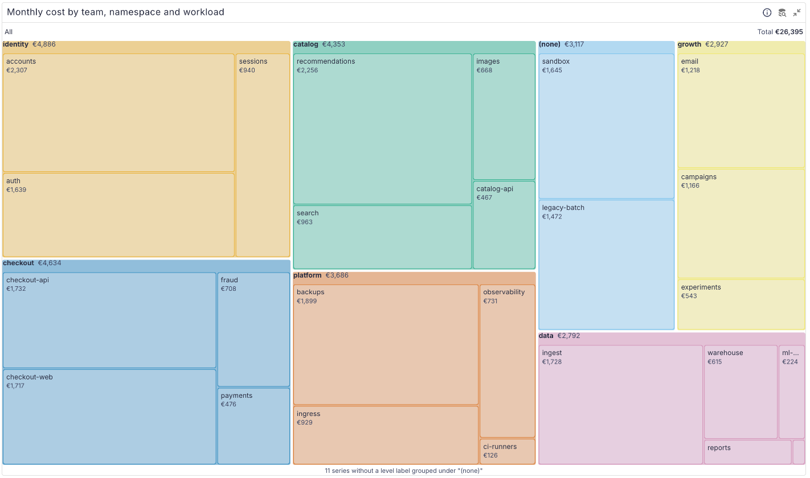
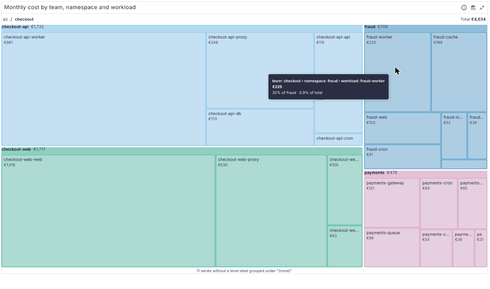
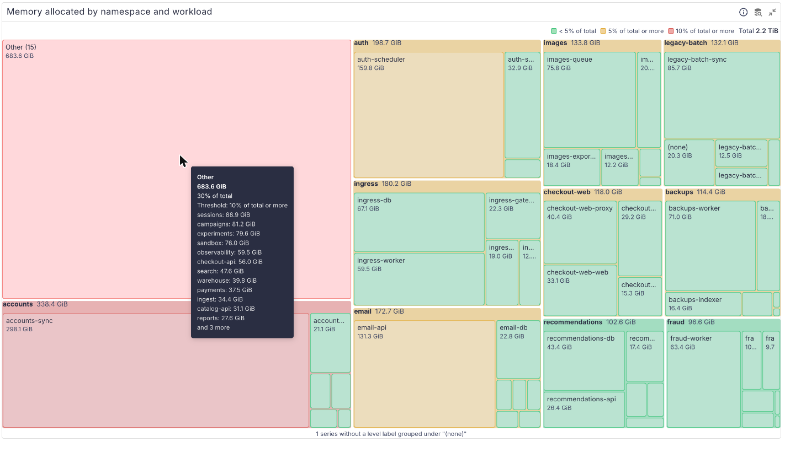
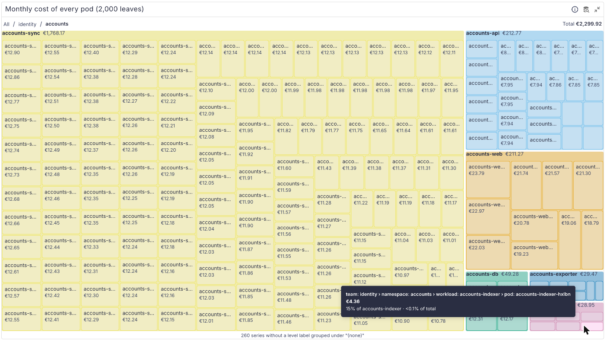

# perses-plugin-treemap

A [Perses](https://perses.dev) panel plugin, `TreemapChart`, that draws a breakdown of a total as
nested boxes, sized by value: cost by team, then namespace, then workload; memory by namespace and
workload; any time series grouped by up to four of its labels. Click a box to open it, and a
breadcrumb leads back up.

<picture>
  <source media="(prefers-color-scheme: dark)" srcset="docs/images/treemap-dark.png">
  
</picture>

```promql
# CPU requests by namespace and pod
sum by (namespace, pod) (kube_pod_container_resource_requests{resource="cpu"})
```

## Supported versions

| Plugin | Perses  | Status              |
| ------ | ------- | ------------------- |
| 0.1.x  | v0.55.x | Tested with v0.55.1 |

The plugin is built against `@perses-dev/*` 0.55.1 and `percli` v0.55.1. Other Perses minor versions
may work but are not tested.

## What it does

- Each series is reduced to one number with a Perses calculation (`last`, `sum`, `mean`, ...).
  `levels` lists the labels of the hierarchy, outermost first (1 to 4): with
  `[team, namespace, workload]`, every series is a workload box inside its namespace inside its
  team. Series with the same labels at every level are summed.
- A series without one of the labels is kept, under a box named `(none)`, and the panel says how
  many series went there. Negative values cannot be drawn; they are left out and counted.
- Boxes show their name and value when they fit; small ones show it on hover. The tooltip gives the
  full path, the value, and the share of the parent and of the total.
- The header shows the total of the level you are looking at.
- **Drill down**: click a box, or focus the chart and press Enter, to open it. The breadcrumb
  (`All › checkout`) leads back; with `showBreadcrumb: false` an Up button does. Escape or Backspace
  goes up a level too.

  <picture>
    <source media="(prefers-color-scheme: dark)" srcset="docs/images/drill-down-dark.png">
    
  </picture>

- **Top N and Other** (`topN`): keep the largest N boxes under each parent, at every level, and sum
  the rest into one `Other (k)` box. Its tooltip lists the members it holds, largest first. A single
  leftover box stays itself rather than becoming an Other of one.
- **Colour** (`colorBy`): `topLevel` (default) gives each outermost box of the current view a
  colour of the Perses chart palette, shared by everything inside it. `thresholds` colours each box
  by its value with Perses thresholds; in percent mode the value compared is the box's share of the
  total. The header shows a legend with the name of each band, and the tooltip names the band too,
  so colour is never the only cue.

  <picture>
    <source media="(prefers-color-scheme: dark)" srcset="docs/images/other-thresholds-dark.png">
    
  </picture>

- **Large data**: only two levels below the open box are drawn at a time, and labels are hidden on
  boxes too small to hold them, so 2,000 leaves stay responsive. Below, a panel of 2,000 pods,
  opened into one workload.

  <picture>
    <source media="(prefers-color-scheme: dark)" srcset="docs/images/pods-dark.png">
    
  </picture>

- Keyboard: the chart is one tab stop. Arrow keys, Home and End move between boxes, Enter or Space
  opens one, and each move is announced to screen readers.
- Light and dark themes follow Perses. The tree is rebuilt only when the data or the options that
  shape it change; hovering never re-renders the panel.

### Spec

```yaml
kind: TreemapChart
spec:
  calculation: last # required; any Perses calculation
  levels: [team, namespace, workload] # 1 to 4 label names, outermost first
  format: { unit: eur, decimalPlaces: 0 } # Perses format (common.#format)
  colorBy: topLevel # topLevel (default) | thresholds
  thresholds: # Perses thresholds (common.#thresholds), used with colorBy: thresholds
    mode: percent # percent of the total
    steps:
      - { value: 5, color: "#e0a526", name: "5% of total or more" }
      - { value: 10, color: "#d9534f", name: "10% of total or more" }
  topN: 8 # optional; largest N under each parent, the rest in Other
  showBreadcrumb: true # default
```

The CUE schema is `schemas/panels/treemap-chart/treemap-chart.cue`, with valid and invalid examples
in `schemas/panels/treemap-chart/tests/`.

## Expected data

Any time series query (Prometheus or another time series datasource) whose series carry the labels
named in `levels`. One series per leaf is typical (`sum by (team, namespace, workload) (...)`), but
the panel sums series that land on the same box, so a finer query works too. The series of several
queries on one panel are added together.

## Examples

Monthly cost by team, namespace and workload, from OpenCost's allocation and price metrics. The team
comes from a `team` label on the namespace and the workload from an `app` label on the pod, both
through kube-state-metrics; change the label names to yours.

```yaml
levels: [team, namespace, workload]
format: { unit: eur, decimalPlaces: 0 }
topN: 8
query: |
  sum by (team, namespace, workload) (
    label_replace(label_replace(
      (
        (
          sum by (namespace, pod, node) (container_cpu_allocation)
            * on (node) group_left () avg by (node) (node_cpu_hourly_cost)
          + sum by (namespace, pod, node) (container_memory_allocation_bytes) / 1073741824
            * on (node) group_left () avg by (node) (node_ram_hourly_cost)
        ) * 730
      )
      * on (namespace, pod) group_left (label_app) kube_pod_labels
      * on (namespace) group_left (label_team) kube_namespace_labels,
      "team", "$1", "label_team", "(.*)"),
      "workload", "$1", "label_app", "(.*)")
  )
```

`kube_pod_labels` and `kube_namespace_labels` only carry the labels kube-state-metrics is told to
export (`--metric-labels-allowlist=pods=[app],namespaces=[team]`). A namespace without a `team`
label lands in `(none)`.

Memory allocation by namespace and workload, coloured by share of the total, with the breadcrumb
off:

```yaml
levels: [namespace, workload]
format: { unit: bytes }
colorBy: thresholds
thresholds:
  mode: percent
  steps:
    - { value: 5, color: "#e0a526", name: "5% of total or more" }
    - { value: 10, color: "#d9534f", name: "10% of total or more" }
topN: 10
showBreadcrumb: false
query: |
  sum by (namespace, workload) (
    label_replace(
      sum by (namespace, pod) (container_memory_allocation_bytes)
        * on (namespace, pod) group_left (label_app) kube_pod_labels,
      "workload", "$1", "label_app", "(.*)")
  )
```

CPU requests by namespace and pod, without OpenCost:

```yaml
levels: [namespace, pod]
format: { unit: decimal }
query: sum by (namespace, pod) (kube_pod_container_resource_requests{resource="cpu"})
```

## Try it locally

`dev/` runs Perses with the plugin, a Prometheus, and a generator of made-up OpenCost-style metrics
(six teams, 25 namespaces, 120 workloads, 2,000 pods; two namespaces have no team label, so `(none)`
shows). The dashboard has three panels: cost by team, namespace and workload; the same down to every
pod; and memory coloured by thresholds. The screenshots above come from it. It needs
`podman compose` or `docker compose`.

```bash
npm ci && npm run build && percli plugin build
cp Treemap-*.tar.gz dev/archive/
podman compose -f dev/docker-compose.yaml up -d    # PERSES_PORT=18083 to move it off 18082
```

Open <http://localhost:18082/projects/demo/dashboards/cost-treemap>. Data appears after Prometheus'
first scrapes, within a minute. `podman compose -f dev/docker-compose.yaml down -v` removes it
again.

## Build

```bash
npm ci
npm run build          # module-federation bundle in dist/
percli plugin build    # writes Treemap-<version>.tar.gz
```

See `CONTRIBUTING.md` for the checks and the release process, and `docs/PLAN.md` and
`docs/DECISIONS.md` for how the plugin is put together and why.

## Install into Perses

Perses extracts every `*.tar.gz` in `plugin.archive_paths` into `plugin.path` at startup. Setting
`archive_paths` replaces the default, so keep the directory of bundled plugins in the list. Pick one
of the three options below and restart Perses.

### Option A: release archive

Download `Treemap-<version>.tar.gz` from the
[GitHub releases](https://github.com/astrona-io/perses-plugin-treemap/releases), put it in a
directory Perses can read, and add that directory to the config:

```bash
curl -fLO https://github.com/astrona-io/perses-plugin-treemap/releases/download/v0.1.0/Treemap-0.1.0.tar.gz
```

```yaml
plugin:
  archive_paths:
    - /etc/perses/plugins-archive # plugins bundled with Perses
    - /etc/perses/plugins-archive-treemap # put Treemap-0.1.0.tar.gz here
```

### Option B: Kubernetes image volume

The `Containerfile` packages the archive as a plugin-only OCI image (`FROM scratch`, the archive at
the image root). Every release publishes it as `ghcr.io/astrona-io/perses-plugin-treemap:v<version>`
for linux/amd64 and linux/arm64, so you can use that image directly. To build and push it to your
own registry instead:

```bash
percli plugin build
podman build -t ghcr.io/<owner>/perses-plugin-treemap:<version> .
podman push ghcr.io/<owner>/perses-plugin-treemap:<version>
```

Then mount it into the Perses pod as an
[image volume](https://kubernetes.io/docs/concepts/storage/volumes/#image) and add the mount path to
`archive_paths` as in option A. Image volumes need a cluster and container runtime that support them
(the `ImageVolume` feature; check your Kubernetes version and feature gates).

```yaml
volumes:
  - name: treemap-plugin
    image:
      reference: ghcr.io/astrona-io/perses-plugin-treemap:v0.1.0
      pullPolicy: IfNotPresent
containers:
  - name: perses
    volumeMounts:
      - name: treemap-plugin
        mountPath: /etc/perses/plugins-archive-treemap
        readOnly: true
```

### Option C: custom Perses image

Copy the archive into the directory of bundled plugins. No config change is needed, because that
directory is in the default `archive_paths`:

```dockerfile
FROM persesdev/perses:v0.55.1
COPY Treemap-0.1.0.tar.gz /etc/perses/plugins-archive/
```

## Licences and credits

The plugin is Apache-2.0 (`LICENSE`). Third-party material and its notices are listed in `NOTICE`:
the Perses shared CUE schemas, vendored into the archive at build time (Apache-2.0).
